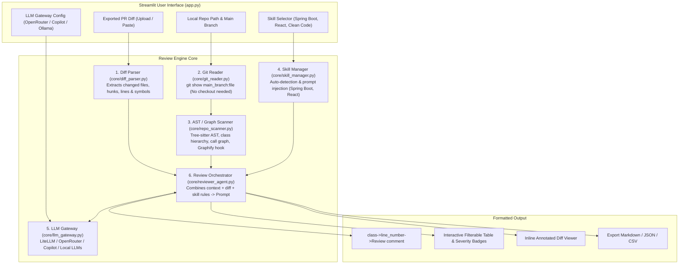

# AI Code Reviewer Agent: Architecture & System Design

## 1. System Overview & Objective

The **Offline AI Code Review Agent** is a developer tool designed to perform in-depth code reviews of Pull Request diffs locally. It addresses key real-world enterprise requirements:
- **Zero Cloud PR Access**: Reviews diffs exported from GitHub or Azure DevOps completely offline without connecting to cloud PR APIs.
- **Whole-Repository Contextual Awareness**: Scans and parses `branch_main` from a local repository clone (using AST/Tree-sitter and Graphify methodology) so the agent understands class hierarchies, method signatures, callers/callees, and project conventions rather than reviewing diff hunks in a vacuum.
- **Strict, Actionable Output**: Standardizes output strictly as:
  $$\text{class} \rightarrow \text{line\_number} \rightarrow \text{Review comment}$$
- **Modular Skill System**: Injects specialized expertise (e.g., `spring-boot-reviewer`, `react-js-reviewer`, `security-reviewer`) dynamically based on changed file types or user selection.
- **Flexible LLM Gateway**: Connects through open-source LLM gateways (LiteLLM SDK / LiteLLM Proxy / OpenRouter / GitHub Copilot / local Ollama).
- **Interactive UI**: Powered by Python Streamlit with live preview, diff viewer, filtering, and export capabilities.

---

## 2. Architecture & Data Flow

---

## 3. Detailed Component Specifications

### 3.1. Diff Parser (`core/diff_parser.py`)
- **Input**: Unified diff text (`.diff` or `.patch`) exported from GitHub (`gh pr diff` or `git diff main...feat > pr.diff`) or Azure DevOps.
- **Parsing**:
  - Parses file headers (`--- a/...`, `+++ b/...`), detects file creation, modification, or deletion.
  - Parses hunks (`@@ -old_start,old_count +new_start,new_count @@`).
  - Maps added (`+`) and modified lines to their **exact new line numbers** in the updated file.
  - Extracts the parent class or enclosing scope (e.g., class name, interface, or functional component name).

### 3.2. Local Git Reader (`core/git_reader.py`)
- **No network calls**: Reads solely from the local filesystem path provided by the user.
- **Non-destructive read**: Uses `git show <main_branch>:<relative_path>` so the user **does not need to switch branches** or stash local work in their active terminal.
- Validates repository integrity, branches available, and file status.

### 3.3. Repo Scanner & AST/Graphify Engine (`core/repo_scanner.py`)
- **The Graphify Evaluation**:
  - Graphify builds a deterministic Tree-sitter knowledge graph of codebases, identifying "God nodes", caller/callee relationships, and communities.
  - *Our Hybrid Approach*:
    1. **Primary Built-in AST Engine**: Extract class definitions, superclasses, imported interfaces, declared methods, and callers using Python AST and lightweight regex/Tree-sitter symbol extractors for Java, TypeScript/JavaScript, and Python.
    2. **Graphify Bridge**: If `graphify` is installed or a `graph.json` exists in `graphify-out/`, the scanner loads the graph to extract multi-hop blast radius (e.g., "Method `foo()` modified in `UserService` is called by 5 classes: `OrderController`, `AuthController`, etc.").
- **Targeted Context Extraction**: Rather than feeding the whole repository into the LLM (which exhausts tokens and causes hallucination), we extract:
  - The complete source of modified classes in `branch_main`.
  - Signatures of classes/interfaces imported by the modified class.
  - Downstream callers (blast radius).

### 3.4. Modular Skills Engine (`core/skill_manager.py`)
Each skill is encapsulated in a directory under `skills/`:
- `skills/<skill_name>/config.yaml`:
  - `name`: Human readable name
  - `description`: Overview
  - `file_patterns`: e.g. `["*.java", "pom.xml"]` for Spring Boot, `["*.tsx", "*.jsx"]` for React
  - `keywords`: e.g. `["@SpringBootApplication", "@Service", "useEffect"]`
- `skills/<skill_name>/rules.md`:
  - Specialized checklist, anti-patterns, framework-specific edge cases, and good/bad code examples.
- **Auto-Detection**: Scans the diff's changed file names and contents against `file_patterns` and `keywords`. In Streamlit, users can toggle auto-detection or manually select/unselect skills.

### 3.5. LLM Gateway (`core/llm_gateway.py`)
- **Abstraction Layer**: Powered by `litellm` (open source).
- **Supported Backends**:
  1. **OpenRouter**: `openrouter/<provider>/<model>` (e.g. `openrouter/anthropic/claude-3.5-sonnet`, `openrouter/meta-llama/llama-3.3-70b-instruct`).
  2. **GitHub Copilot / GitHub Models**:
     - Using GitHub Personal Access Token / Copilot token with GitHub Models (`github/gpt-4o`, etc.) or LiteLLM Copilot provider.
     - Or connecting to a local Copilot Proxy / LiteLLM Proxy endpoint (`http://localhost:4000/v1`).
  3. **Local LLMs**: Ollama (`ollama/qwen2.5-coder:14b`), vLLM, or LM Studio (`http://localhost:1234/v1`).
  4. **Direct Cloud Providers**: OpenAI, Anthropic, Gemini, Azure OpenAI.
- **Prompt Engineering & Output Enforcement**:
  - Enforces structured JSON or strict delimiter generation (`class->line_number->Review comment`).
  - Strict fallback parser to guarantee regex matching of the required format.

### 3.6. Streamlit User Interface (`app.py`)
- Clean, 2-column and tabbed layout.
- Real-time validation of repository path and git branches.
- Diff upload via drag-and-drop or raw text paste.
- Step-by-step progress tracking with expandable debug logs.
- Interactive results table with severity filters (Critical, Warning, Suggestion) and one-click copy of the raw format.
- Export to Markdown, JSON, and CSV.
